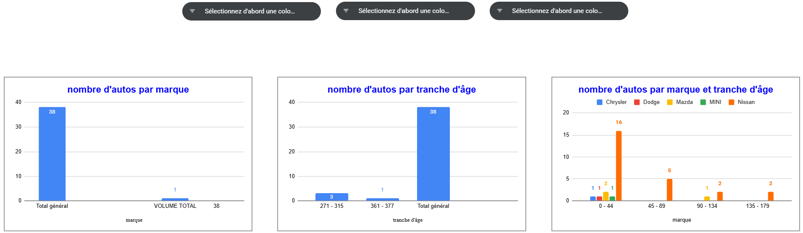

# Portfolio Professionnel — Analyse d'Affaires & Optimisation des Processus

Bienvenue sur mon espace portfolio dédié à l'analyse d'affaires, à la modélisation des processus (BPMN 2.0) et au pilotage de la performance opérationnelle. Ce dépôt rassemble des cas pratiques issus de projets académiques (HEC Montréal) et d'expériences professionnelles sur le terrain.

---

## 📂 Projets Inclus

### 1. Diagnostic de l'Existant (AS-IS) — Fonderie Ultra (HEC Montréal)
* **Contexte :** Projet académique réalisé dans le cadre du Certificat en Analyse d'Affaires à **HEC Montréal** (Cours *TECH 30710 — Gestion des processus d'affaires*).
* **Objectif :** Analyse détaillée et modélisation multi-niveaux sous la norme BPMN 2.0 du processus de traçabilité de la production (ordonnancement, chargement des fours, transferts PLC), couplée à une analyse causale (Diagramme d'Ishikawa) pour identifier les goulets d'étranglement et réduire les rejets.
* **Livrables :** [Consulter le rapport de diagnostic complet (PDF)](./Diagnostic_Fonderie_HEC.pdf)
* 💡 **Note de conception :** J'ai réalisé l'intégralité du diagnostic sur le terrain, l'analyse des processus opérationnels et la modélisation BPMN 2.0. J'ai utilisé l'assistance d'outils d'Intelligence Artificielle Générative (IAG) pour structurer la rédaction et optimiser la mise en page visuelle du document.

---

### 2. Dashboard de Pilotage & Analyse de Performance (Concession Automobile)
* **Contexte :** Projet professionnel de gestion des stocks et de pilotage de la performance réalisé au sein d'une concession automobile (département véhicules d'occasion).
* **Objectif :** Traitement des données d'inventaire, modélisation des indicateurs clés (volume global, tranches d'âge, segmentation par marque) et mise en place d'un tableau de bord décisionnel pour réduire le stock critique et optimiser la rotation.
* **Aperçu du Tableau de Bord :**

* **Livrables associés :**
  * [Consulter le Rapport d'Actions Prioritaires (PDF)](./Rapport_Actions_Prioritaires_Concession_Automobile.pdf)
* 💡 **Note de conception :** J'ai réalisé l'ensemble des analyses de terrain, l'extraction de l'inventaire et la formulation des recommandations stratégiques. J'ai utilisé l'assistance d'outils d'Intelligence Artificielle Générative (IAG) pour optimiser la structure, la rédaction et le design visuel du rapport.

---

**Auteur :** Mohammed Laroui  
**Profil :** Certificat en analyse d'affaires (Profil PGI) — HEC Montréal
